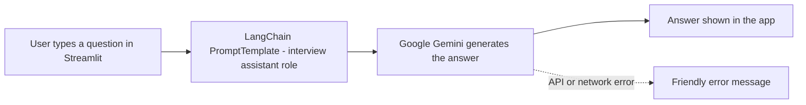

<div align="center">

# 🎯 Interview Preparation Bot

**An AI chatbot that helps you prepare for job interviews: common questions, answer structure, the STAR method and technical tips.**


</div>

---

## 📌 Overview

Interview preparation advice is scattered across blogs and videos, and it is rarely tailored to the question you are actually worried about. This project is a focused assistant: type any interview-related question and get a clear, structured answer.

It uses a **LangChain prompt template** to give the model a fixed role (interview preparation assistant) and **Google Gemini** to generate the answers. Questions that have nothing to do with interviews are politely redirected, so the bot stays on topic.

## ✨ Features

- 💬 **Ask anything about interviews:** behavioral, HR, technical and role-specific questions
- ⭐ **STAR method coaching:** learn to structure Situation, Task, Action and Result answers with examples
- 🧭 **Structured answers:** frameworks, templates, do's and don'ts, and sample responses
- 🚧 **Stays on topic:** unrelated questions (for example a recipe) are redirected back to interview preparation
- 🛡️ **Error handling:** API and network problems show a friendly message instead of crashing the app
- 🔑 **Secure key handling:** the API key is loaded from a `.env` file, never hard-coded

## 🏗️ How It Works



1. The user enters an interview-related question in a text box.
2. The question is inserted into a `PromptTemplate` that instructs the model to act as an interview preparation assistant.
3. The filled prompt is sent to Gemini, which returns a structured answer.
4. The answer is displayed in the app.
5. If the question is not about interviews, the bot redirects the user to interview topics.
6. Errors are caught and shown as a message.

## 🧪 Example Conversations

| Question | What the bot does |
|---|---|
| **Hi** | Greets the user and lists what it can help with: behavioral questions, tricky questions, technical tips, questions to ask the interviewer |
| **Tell me about yourself? How to give a self introduction.** | Explains the **Present-Past-Future** framework with a fill-in template and tips |
| **What is your biggest weakness?** | Gives a **Weakness + Action + Result** formula, what to avoid, and three sample answers |
| **Why should we hire you?** | Provides a 3-part answer formula, preparation steps and a template |
| **How do I answer a behavioral question using the STAR method?** | Breaks down Situation, Task, Action and Result with timing and a worked example |
| **What's the recipe for pasta carbonara?** | Politely declines and redirects to interview preparation |

## 🛠️ Tech Stack

| Area | Tools |
|---|---|
| Language | Python |
| LLM framework | LangChain (`langchain`, `langchain-core`) for the prompt template and chaining |
| Language model | Google Gemini via `langchain-google-genai` |
| Web interface | Streamlit |
| Configuration | python-dotenv for loading the API key from `.env` |

## 📂 Project Structure

```
interview-preparation-bot/
├── app.py              # Streamlit UI, prompt template and Gemini chain
├── requirements.txt    # Python dependencies
├── .env.example        # Example of the environment file (no real key)
├── .gitignore
└── README.md
```

## 🚀 Run Locally

```bash
# 1. Clone the repository
git clone https://github.com/Navyachalla21/interview-preparation-bot.git
cd interview-preparation-bot

# 2. Create and activate a virtual environment
python -m venv venv
venv\Scripts\activate          # Windows
# source venv/bin/activate     # macOS / Linux

# 3. Install dependencies
pip install -r requirements.txt

# 4. Add your Gemini API key
#    Copy .env.example to .env and set:
#    GOOGLE_API_KEY=your_key_here

# 5. Run the app
streamlit run app.py
```

Get a free Gemini API key from [Google AI Studio](https://aistudio.google.com/). Never commit your `.env` file.

## 🔮 Future Improvements

- Mock interview mode: the bot asks the questions and scores your answers
- Role-specific question banks (software, data, HR, management)
- Conversation memory so follow-up questions keep context
- Upload a resume or job description to get tailored questions
- Deploy on Streamlit Community Cloud or Hugging Face Spaces

## ⚠️ Note

The answers are AI-generated guidance for practice. Adapt them to your own experience and the specific role, and never present made-up achievements in a real interview.

## 👩‍💻 Author

**Navya Shree K N**

GitHub: [@Navyachalla21](https://github.com/Navyachalla21)

---

<div align="center">

⭐ If this project helped you, consider giving the repository a star.

</div>